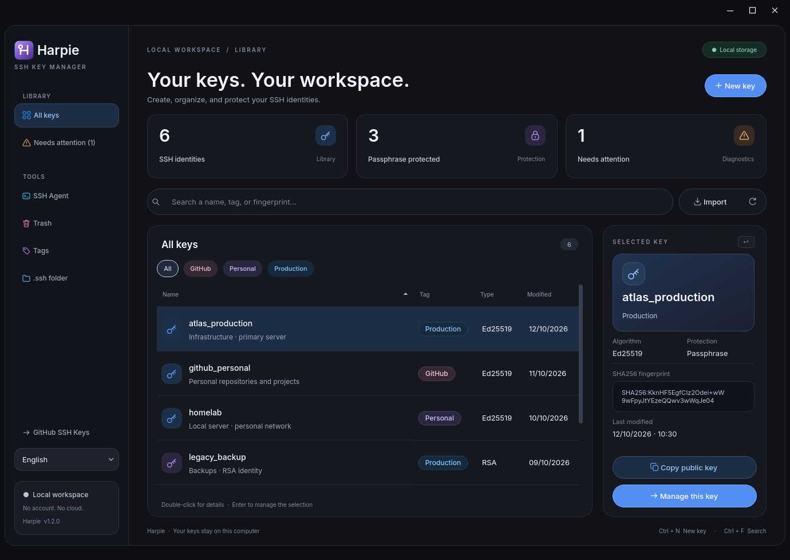
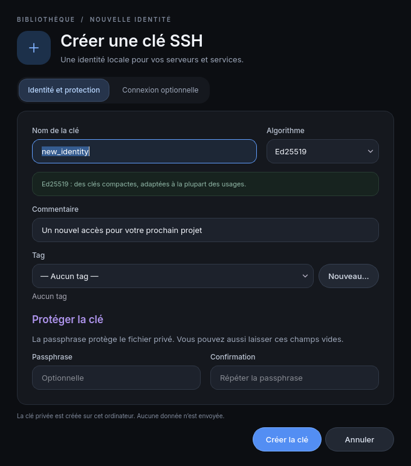
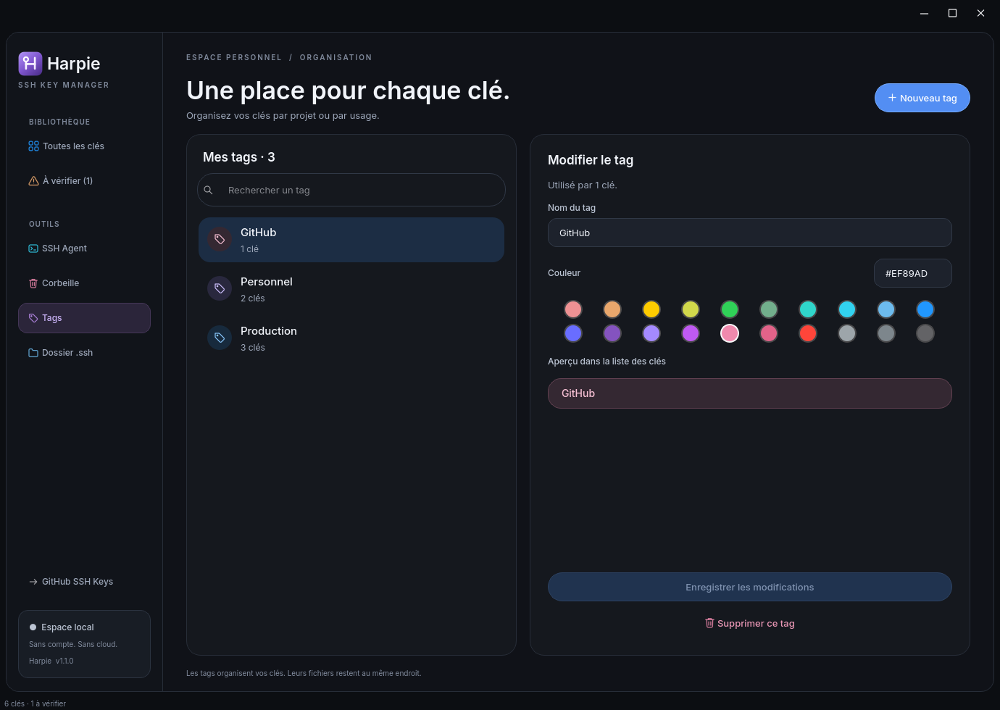

<div align="center">
  
  <h1>Harpie</h1>
  <p><strong>Your keys. Your workspace.</strong></p>
  <p>A local SSH key manager for Windows, built for a quieter daily workflow.</p>
  <p>
    <a href="https://github.com/HarpieDev/SSHKeyManager/actions/workflows/ci.yml"></a>
    <a href="https://github.com/HarpieDev/SSHKeyManager/releases/latest"></a>
    
    
  </p>
  <p><a href="https://github.com/HarpieDev/SSHKeyManager/releases/latest">Download</a> · <a href="#getting-started">Getting started</a> · <a href="#development">Development</a> · <a href="CHANGELOG.md">Changelog</a></p>
</div>



Harpie brings your SSH identities, tags, connection settings, and recovery tools into one desktop workspace. No account, cloud sync, telemetry, or background network requests. The complete interface is available in **English and French**. Switch languages from the sidebar at any time; your preference is remembered, and your keys and unsaved tag drafts stay intact.

## What you can do

| Workspace | Capabilities |
| --- | --- |
| **Create & organize** | Generate Ed25519 or RSA 4096 identities, add optional passphrases, search, sort, and organize with colored tags. |
| **Inspect & protect** | View public keys and SHA256 fingerprints; detect missing key files, mismatched pairs, and overly broad file permissions. |
| **Connect** | Save host, user, and port settings; launch OpenSSH connections; add or remove identities from Windows SSH Agent. |
| **Import & recover** | Import OpenSSH or PEM private keys, export keys, rebuild missing public keys, and restore deleted identities from Harpie's local trash. |

The workspace includes live library counts, a selection inspector, keyboard shortcuts, and a compact layout for smaller windows. Inter is bundled with the app, and the integrated window frame supports Windows dragging, resizing, and maximize controls.

<details>
<summary>More screenshots</summary>





All screenshots use disposable demo identities, generated in an isolated directory.

</details>

## Getting started

1. Download `Harpie-1.2.1-setup-x64.exe` from the [latest release](https://github.com/HarpieDev/SSHKeyManager/releases/latest).
2. Run the installer, choose English or French, then open **Harpie** from the Windows Start menu. Installation is per user and does not require administrator rights.
3. Create or import an identity. Install its **public** key on your server or GitHub account before connecting.

Prefer no installation? Download `Harpie-1.2.1-windows-x64.zip`, extract it, and launch `Harpie.exe`. Python is bundled in both formats. Uninstalling Harpie removes application files and shortcuts while preserving your SSH keys and preferences.

Target platform: **Windows 10/11, x64**. The installer and application are currently unsigned. OpenSSH Client is needed for connections and agent commands; key creation and local key management work without it. To use SSH Agent, enable the Windows **OpenSSH Authentication Agent** service. Agent passphrases are entered directly in its terminal.

To check a download, compare its hash with `SHA256SUMS.txt` from the same release:

```powershell
Get-FileHash .\Harpie-1.2.1-setup-x64.exe -Algorithm SHA256
```

### Keyboard shortcuts

| Shortcut | Action |
| --- | --- |
| `Ctrl + N` | Create a key |
| `Ctrl + F` | Focus search |
| `F5` | Refresh the library |
| `Enter` / double-click | Open the selected identity |
| `Alt + Space` | Open the Windows system menu |

## Your data stays on your computer

| Data | Location |
| --- | --- |
| SSH keys and OpenSSH configuration | `%USERPROFILE%\.ssh` |
| Recoverable deleted keys | `%USERPROFILE%\.ssh\.harpie-trash` |
| Tags and key metadata | `%APPDATA%\HarpieSSH\metadata.json` |
| Rotating logs | `%LOCALAPPDATA%\HarpieSSH\logs` |

Passphrases are handled in memory by `cryptography`; Harpie does not put them in process arguments, temporary passphrase files, or logs. New private keys and private exports restrict access to the current user, SYSTEM, and Windows administrators. The private key is never displayed, and exporting it requires confirmation.

Existing key files are never overwritten. OpenSSH configuration changes use atomic writes and a `config.harpie.bak` backup. Renaming updates matching key references; deleting removes the associated `IdentityFile` directives while preserving other host options. Restore operations retain tags and avoid overwriting newer configuration changes.

The local trash is **not a backup**: it is lost if the drive is lost. Back up important identities independently. PuTTY `.ppk` files must be converted to OpenSSH with PuTTYgen before import. Fully verifying an encrypted private key requires its passphrase. Network access happens only when you explicitly connect to a server or open a GitHub link.

## Development

Use **Python 3.12–3.14** on Windows. CI tests Python 3.12 and 3.14; the executable is built with Python 3.14. Dependencies are pinned in `requirements.txt`.

```powershell
git clone https://github.com/HarpieDev/SSHKeyManager.git
cd SSHKeyManager
python -m venv .venv
.venv\Scripts\python.exe -m pip install -r requirements.txt
.venv\Scripts\python.exe main.py
```

### Tests and isolated diagnostics

```powershell
.venv\Scripts\python.exe -B -m unittest discover -s tests -v
```

Tests generate their own keys in temporary project directories. They never read or modify your real SSH identities. For a complete application diagnostic, `--self-check` requires `HARPIE_HOME` to isolate keys, metadata, logs, and settings:

```powershell
$env:HARPIE_HOME = Join-Path $PWD '.review\self-check'
.venv\Scripts\python.exe main.py --self-check
Get-Content "$env:HARPIE_HOME\self-check.json"
Remove-Item Env:HARPIE_HOME
```

Do not set `HARPIE_HOME` for normal use. To regenerate UI screenshots with disposable identities:

```powershell
.venv\Scripts\python.exe tools\capture_ui.py
```

### Build a Windows release

```powershell
powershell -NoProfile -ExecutionPolicy Bypass -File tools\build_release.ps1 -Python .venv\Scripts\python.exe -WithInstaller
```

Install [Inno Setup 6](https://jrsoftware.org/isinfo.php) to build the installer. Omit `-WithInstaller` to build only the portable ZIP. The script runs tests, regenerates icons and Windows version metadata, builds the executable, verifies its isolated startup in both languages, and packages documentation and third-party licenses. Output is written to `dist\release`, including checksums for each download.

The [release workflow](https://github.com/HarpieDev/SSHKeyManager/blob/main/.github/workflows/release.yml) repeats this process on a version tag and publishes the assets only after verification. See [CONTRIBUTING.md](CONTRIBUTING.md) for the release checklist.

## Project layout

```text
core/          Key material, storage, permissions, metadata, SSH configuration
ui/            Desktop workspace, dialogs, widgets, and visual tokens
assets/        Harpie identity, SVG icons, and bundled Inter font
installer/     Bilingual per-user Windows setup
tests/         Isolated key-management and UI regression tests
tools/         Build, packaging, version metadata, and screenshot utilities
.github/       Windows CI, release automation, and issue templates
```

## Credits and dependency licenses

Built with [Qt for Python / PySide6](https://doc.qt.io/qtforpython-6/) and [cryptography](https://cryptography.io/). The bundled [Inter](https://rsms.me/inter/) font is distributed under SIL Open Font License 1.1; its license is in `assets/fonts/OFL.txt`. Dependency license texts accompany release archives. See [THIRD_PARTY_NOTICES.md](THIRD_PARTY_NOTICES.md). No open-source license is granted for Harpie itself by this repository.
